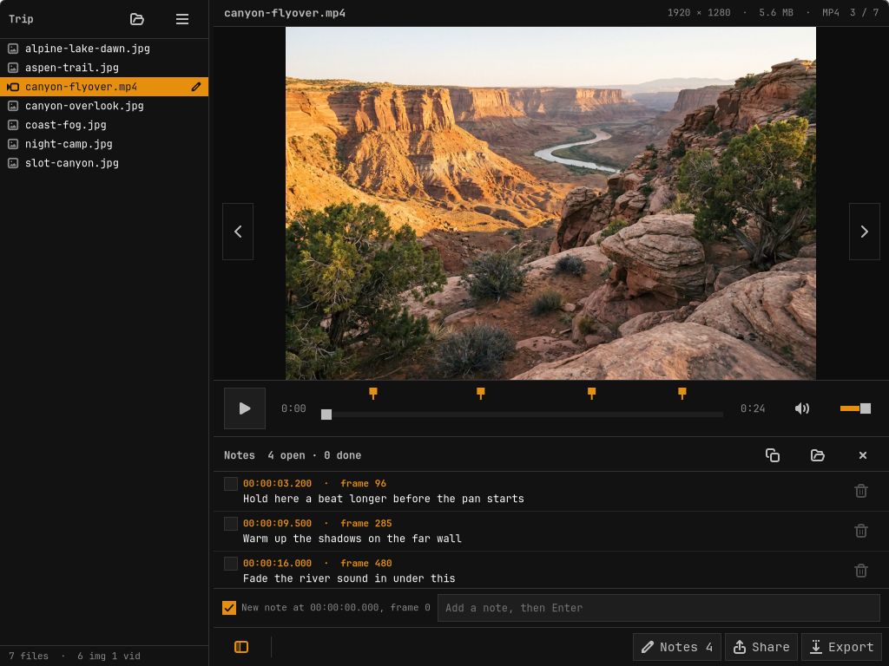

<p align="center">
  <picture>
    <source media="(prefers-color-scheme: dark)" srcset="data/brand/seerstone-lockup-on-dark.svg">
    
  </picture>
</p>

# Seerstone

A simple media browser for Omarchy. Open a folder and every image, PDF, audio,
and video file in it is listed in a compact sidebar. Click one, or flip through
them with the arrow keys.

- **Images and PDFs** fit the window by default, letterboxed, and re-fit as the
  window or sidebar changes size. Zoom in and out (buttons, `+`/`−`, Ctrl+scroll,
  pinch, double-click for 100%), drag to pan when zoomed, and rotate in 90-degree
  steps. A rotation can be saved back to the file (with Undo); unsaved rotations
  are remembered per file until you close the app. Multi-page PDFs get page buttons.
- **Video** plays at the aspect ratio it shipped with, letterboxed. **Audio**
  shows cover art, tags, and a waveform you can click or drag to seek. Both
  share one transport bar: play/pause, scrubber, time, volume.
- **Share**: copy the image (rotated as shown), copy the file (paste it into a
  folder, chat, or LocalSend), copy the path, Open With…, Show in Folder.
- **Export** to another format, written next to the original by default:
  images to PNG/JPEG/WebP/AVIF/HEIC/TIFF/GIF/BMP/PDF (rotation applied); PDFs to
  PDF (rotation applied) or the current page as PNG/JPEG; video to MP4/WebM/MKV/
  MOV/animated GIF or audio-only MP3/M4A; audio to MP3/M4A/OGG/Opus/FLAC/WAV.
- **Notes**, for reviewing assets and handing feedback to an AI: press **N** (or
  the Notes button) and type. On video the note is pinned to the exact frame, on
  audio to the moment, on a PDF to the page, and on an image to the whole file.
  Notes slide up from the bottom of the media pane, just above the toolbar; drag
  the top edge to make the drawer taller or shorter. Timed notes show as markers
  on the scrub bar (and the audio waveform): hover
  for the note, click to jump to it. Tick notes off as done, double-click to edit.
- **Open Recent** (☰ menu) lists the last 10 folders.
- **Sidebar**: drag the handle to resize it, hide it (button at bottom left,
  F9, or Ctrl+B), and dock it on the left, top, right, or bottom (☰ menu).
  Top and bottom make it a strip that scrolls sideways. All of this is remembered.

Colors and font follow the active Omarchy theme and change live with
`omarchy theme set`.



## Install

From the Omarchy plugin marketplace:

    omarchy plugin add https://github.com/SuperCleanse/omarchy-seerstone.git --enable
    ~/.config/omarchy/plugins/supercleanse.seerstone/install.sh

The plugin adds a Seerstone button to the bar (right section; move it with
`omarchy bar move`). Plugins never run install scripts on their own, so the
second line installs the app itself. If you skip it, the first click on the bar
button runs it for you in a terminal.

Or from a clone:

    git clone https://github.com/SuperCleanse/omarchy-seerstone.git
    cd omarchy-seerstone && ./install.sh

`install.sh` installs any missing prerequisites first (asking for your password via
`sudo pacman`), and stops if it can't: GTK 4, PyGObject, glycin, Poppler,
GStreamer with the base/good/bad plugins and **gst-libav**, FFmpeg,
ImageMagick, qpdf, and wl-clipboard. `./install.sh --check` just lists what's
missing. gst-libav is required because without it H.264 falls back to
openh264 (slow, and it stops producing frames after decoding to end-of-file)
and iPhone HEVC video doesn't play at all.

Then Super+Space → Seerstone, or `seerstone [folder or file]`. Passing a file
opens its folder with that file selected; a second `seerstone <path>` reuses the
open window. It's listed under "Open With" for media types but is not made the
default for anything.

## Remove

    ~/.config/omarchy/plugins/supercleanse.seerstone/install.sh --uninstall
    omarchy plugin remove supercleanse.seerstone

(From a clone, run `./install.sh --uninstall` there.) That removes the
`seerstone` command, the launcher entry, and the icon. It leaves the
prerequisite packages, your notes files (they sit beside your media), and
Seerstone's settings in `~/.config/seerstone/`, which you can delete by hand.

## Notes files

Each media file's notes live beside it, named after the full file name, so
`intro.mp4` gets `intro.mp4.notes.md`. Seerstone never lists `*.notes.md` files
as media; they open only as the notes panel of their file. The format is a
Markdown checklist, one note per line, written in time/page order:

```
# Notes on intro.mp4

- [ ] 00:01:23.400 (frame 2502): Logo comes in too early. Delay it one second.
- [x] 00:02:05.000 (frame 3750): Replace with the wide shot.
- [ ] Music is too loud under the voice.
```

Audio notes are `- [ ] 00:00:12.500: text`, PDF notes `- [ ] page 3: text`.
Hand the file (or Copy Notes, which adds the full path) to an AI; it can tick
items off or add notes, and Seerstone picks up outside edits live.

## Keys

| Key | Does |
|:--|:--|
| ↑ ↓ | Previous / next file |
| ← → | Images/PDFs: previous / next file. Video: one frame (hold to scrub, it speeds up). Audio: 50 ms nudges |
| , . | One frame back / forward |
| N / Shift+N | New note here (pauses) / show-hide notes |
| Esc | Leave the note box |
| Home / End | First / last file |
| + / − / 0 / 1 | Zoom in / out / fit / 100% |
| R / Shift+R | Rotate clockwise / counterclockwise |
| Ctrl+S | Save rotation to the file |
| PgUp / PgDn | PDF page |
| Space, M | Play/pause, mute |
| Shift+← → | Back / forward 5 seconds |
| Ctrl+C | Copy image (or file) |
| Ctrl+E | Export |
| Ctrl+O | Open folder |
| F / F11, Esc | Fullscreen |
| F9 / Ctrl+B | Show / hide sidebar |
| ? | Shortcut list |

## Notes

- Audio and video play through Seerstone's own player (`seerstone/player.py`:
  GStreamer playbin, frames handed to GTK), not `Gtk.MediaFile`. GTK's built-in
  backend froze after a click near the end of an H.264 video, dropped clicks made
  while a file was opening, queued a full decode per drag step, aborted on plain
  `.mp3` files, and crashed when a player was torn down right after being made.
- Scrubbing: a click lands on the exact frame. Where exact seeks are slow (big,
  long-keyframe H.264 on a software decoder), it shows the nearest keyframe at
  once and swaps in the exact frame when decoded. While dragging, fast media show
  exact frames live; slow media preview keyframes and show the exact frame when
  the knob holds still or is released.
- gst-libav (a prerequisite, see Install) gives GStreamer FFmpeg's decoders,
  which outrank openh264 (primary vs. marginal), so they're used automatically:
  iPhone HEVC plays, and H.264 decodes several times faster, so exact frames
  arrive sooner. If a system ends up on openh264 anyway, the player still copes:
  it detects openh264's stop-after-end-of-file behavior and resets the pipeline.
- Every video frame goes to GTK with its color description (matrix, transfer,
  primaries, range). Where a file leaves some of those unset, as ffmpeg does
  when it makes video from JPEGs, Seerstone fills them in the way players do
  (BT.709 for HD, BT.601 for SD) rather than let GTK treat the picture as RGB.
- Saves and exports write a hidden temp file and only replace the target when the
  tool succeeds. Originals replaced by "Save Rotation" are kept for a week in
  `~/.cache/seerstone/undo/`.
- State (last folder, sidebar dock/size, autoplay, volume) lives in
  `~/.config/seerstone/state.json`.

## Development

Never put test windows on the live desktop. Render offscreen with Broadway:

    gtk4-broadwayd :7 &
    GDK_BACKEND=broadway BROADWAY_DISPLAY=:7 bin/seerstone ~/some/folder \
        --render-png /tmp/shot.png --select photo.jpg --rotate 1 --dock top
    GDK_BACKEND=broadway BROADWAY_DISPLAY=:7 python3 tests/smoke.py

`--render-png` runs under its own app id and never reads or writes the saved
state. The smoke test builds throwaway fixtures with ffmpeg/magick and drives
the real window: navigation, MP3/video playback, rotate/save/undo, zoom, resize
re-fit, sidebar hide/dock/drag, clipboard, frame stepping and hold-to-scrub,
notes (format, saving, markers, outside edits), Open Recent, and every export path.

Scrubbing has its own torture test. `tests/make_media.py` builds videos in ten
formats whose every frame carries its frame number as black/white blocks, and
`tests/scrub.py` reads the frame on screen after every click, drag storm, rapid
click burst, frame step, click-while-playing, and click-after-the-end, checking it
is exactly the right one and timing it (audio files too). `tests/playback.py`
checks normal playback doesn't drop frames, and `tests/color.py` checks every
video, including ones with missing color tags, gets a color description.

    GDK_BACKEND=broadway BROADWAY_DISPLAY=:7 python3 tests/scrub.py [--quick] [--only NAME]
    GDK_BACKEND=broadway BROADWAY_DISPLAY=:7 python3 tests/playback.py
    python3 tests/color.py

`SEERSTONE_DEBUG=1` logs every seek the player issues, lands, retries, repairs,
or resets. The test media includes an iPhone-style HEVC `.mov` (open GOP); the
scrub test clicks the frames just before keyframes and steps across them, which
is where exact seeks on such streams go wrong without the player's repair.

## License

MIT. See [LICENSE](LICENSE).
